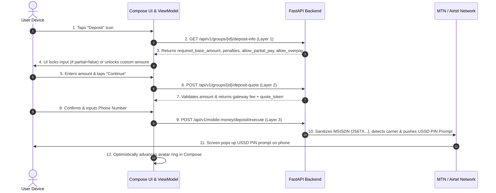

# Android UI Architecture & Real-Time Specifications (Microbond Dashboard)

This document outlines the native Android client architecture, Jetpack Compose UI components, Drift SQLite local persistence, and real-time WebSocket state synchronization for the Microbond main dashboard.

---

## 1. Jetpack Compose UI Components

### A. Segmented Avatar Progress Ring (`GroupAvatarRing.kt`)
Each group item in the dashboard displays an avatar encircled by a dynamic, segmented ring:
* **Green Segment (`paid_on_time_count`)**: Arc drawn in `#00E676` or `#00C853` representing successful payments made on time.
* **Red Segment (`missed_deadline_count`)**: Arc drawn in `#FF5252` representing members in arrears or overdue past the grace period.
* **Neutral Segment (Pending)**: Remaining arc in `#37474F` for members whose deadline has not yet passed.
* **Animation**:
  * Driven by `animateFloatAsState(animationSpec = tween(400, easing = FastOutSlowInEasing))`.
  * **Optimistic Local Advance**: The moment the user clicks "Deposit", the green arc immediately advances by `1 / total_members` with 0ms network latency.

```kotlin
@Composable
fun GroupAvatarRing(
    totalMembers: Int,
    paidCount: Int,
    missedCount: Int,
    avatarUrl: String?,
    modifier: Modifier = Modifier
) {
    val total = if (totalMembers > 0) totalMembers else 1
    val greenFraction by animateFloatAsState(targetValue = paidCount.toFloat() / total)
    val redFraction by animateFloatAsState(targetValue = missedCount.toFloat() / total)

    Box(modifier = modifier.size(54.dp), contentAlignment = Alignment.Center) {
        Canvas(modifier = Modifier.fillMaxSize()) {
            val strokeWidth = 3.dp.toPx()
            val diameter = size.minDimension - strokeWidth
            val radius = diameter / 2f
            val center = Offset(size.width / 2f, size.height / 2f)

            // Background / Pending Arc
            drawCircle(
                color = Color(0xFF263238),
                radius = radius,
                style = Stroke(width = strokeWidth)
            )

            // Green (Paid on time) Arc
            if (greenFraction > 0f) {
                drawArc(
                    color = Color(0xFF00E676),
                    startAngle = -90f,
                    sweepAngle = greenFraction * 360f,
                    useCenter = false,
                    style = Stroke(width = strokeWidth, cap = StrokeCap.Round)
                )
            }

            // Red (Missed Deadline) Arc
            if (redFraction > 0f) {
                drawArc(
                    color = Color(0xFFFF5252),
                    startAngle = -90f + (greenFraction * 360f),
                    sweepAngle = redFraction * 360f,
                    useCenter = false,
                    style = Stroke(width = strokeWidth, cap = StrokeCap.Round)
                )
            }
        }
        
        // Inner Avatar
        AsyncImage(
            model = avatarUrl ?: R.drawable.ic_group_placeholder,
            contentDescription = "Group Icon",
            modifier = Modifier.size(44.dp).clip(CircleShape)
        )
    }
}
```

### B. Animated Action Message Ticker (`ActionMessageTicker.kt`)
The subtitle text under each group name does not stay static; it smoothly cycles (slides up and fades away) between multiple contextual status messages every 4–5 seconds:
* For `MERRY_GO_ROUND`: Cycles between:
  1. *"Sara is receiving in this round (Friday)"*
  2. *"Your payout turn is in 2 weeks (24 Oct)"*
  3. *"Last round completed on time"*
* For `EVENT_COMMITTEE` / Wedding Fund: Cycles between:
  1. *"Sara contributed 50,000 UGX for wedding cake"*
  2. *"Wedding fund target reached at 80%"*
* **Compose Animation**: Driven by `AnimatedContent` with `slideInVertically` + `slideOutVertically` + `fadeIn` / `fadeOut`.

```kotlin
data class ActionMessage(
    val text: String,
    val type: String,
    val hasBlueTicks: Boolean = true,
    val isAlert: Boolean = false
)

@Composable
fun ActionMessageTicker(
    messages: List<ActionMessage>,
    modifier: Modifier = Modifier
) {
    if (messages.isEmpty()) return

    var currentIndex by remember { mutableStateOf(0) }

    LaunchedEffect(messages) {
        while (messages.size > 1) {
            delay(4000L) // Wait 4 seconds before animating away
            currentIndex = (currentIndex + 1) % messages.size
        }
    }

    val currentMsg = messages[currentIndex]

    AnimatedContent(
        targetState = currentMsg,
        transitionSpec = {
            (slideInVertically { height -> height } + fadeIn()) togetherWith
            (slideOutVertically { height -> -height } + fadeOut())
        },
        label = "ActionMessageTickerTransition"
    ) { msg ->
        Row(
            verticalAlignment = Alignment.CenterVertically,
            horizontalArrangement = Arrangement.spacedBy(4.dp),
            modifier = modifier
        ) {
            if (msg.isAlert) {
                Icon(
                    imageVector = Icons.Default.ErrorOutline,
                    contentDescription = "Alert",
                    tint = Color(0xFFFF5252),
                    modifier = Modifier.size(14.dp)
                )
            } else if (msg.hasBlueTicks) {
                Icon(
                    imageVector = Icons.Default.DoneAll,
                    contentDescription = "Read",
                    tint = Color(0xFF40C4FF),
                    modifier = Modifier.size(14.dp)
                )
            }

            Text(
                text = msg.text,
                style = MaterialTheme.typography.bodySmall,
                color = if (msg.isAlert) Color(0xFFFF8A80) else Color(0xFF90A4AE),
                maxLines = 1,
                overflow = TextOverflow.Ellipsis
            )
        }
    }
}
```

### C. Unread & Notification Badges (`UnreadBadge.kt`)
* **Numeric Badge**: Shows exact unread count in pill or circle shape.
  * Active/Important alerts: `#FF9100` (Orange) or `#00E676` (Green).
  * Zero / Seen: Hidden or discreet gray indicator.

---

## 2. Drift SQLite Local Persistence & Optimistic Outbox

### Tables in Drift
1. **`GroupSummariesTable`**:
   * `groupId: String (PK)`
   * `groupName: String`
   * `groupType: String`
   * `avatarUrl: String?`
   * `totalMembers: Int`
   * `paidCount: Int`
   * `missedCount: Int`
   * `latestMessage: String`
   * `isAlert: Boolean`
   * `hasBlueTicks: Boolean`
   * `unreadCount: Int`
   * `updatedAt: Long`

2. **`PendingPaymentOutbox`**:
   * Stores pending local deposits to drive instant 0ms optimistic UI updates before network completion.

---

## 3. Real-Time WebSocket Event Listeners

The Android client maintains an active WebSocket connection to `/api/v1/ws/groups/dashboard`:

| Event Type | Action on Client |
|---|---|
| `RING_STATUS_UPDATED` | Updates `paidCount` & `missedCount` in Drift SQLite; automatically triggers animated arc re-draw. |
| `NEW_GROUP_MESSAGE` | Updates `latestMessage`, `hasBlueTicks`, increments `unreadCount` by 1. |
| `UNREAD_COUNT_CLEARED` | Resets `unreadCount = 0` when the user enters the chat room. |
| `GROUP_IMAGE_UPDATED` | Updates `avatarUrl` in Drift SQLite and refreshes Coil/AsyncImage cache. |
| `GROUP_IMAGE_UPDATED` | Updates `avatarUrl` in Drift SQLite and refreshes Coil/AsyncImage cache. |
| `CYCLE_RESET` | Resets `paidCount = 0` and `missedCount = 0` for the new rotation period. |

---

## 4. 3-Tier Mobile Deposit Pipeline (Android Flow)

When the user taps the **Deposit** icon on a group item:



### Retrofit Service Interface Blueprint
```kotlin
interface MicrobondDepositApiService {

    // Layer 1: Fetch Group Deposit Rules & User Arrears
    @GET("api/v1/groups/{groupId}/deposit-info")
    suspend fun getDepositInfo(
        @Path("groupId") groupId: String
    ): Response<DepositInfoResponseDto>

    // Layer 2: Validate Amount & Calculate Mobile Money Fees
    @POST("api/v1/groups/{groupId}/deposit-quote")
    suspend fun calculateDepositQuote(
        @Path("groupId") groupId: String,
        @Body request: DepositQuoteRequestDto
    ): Response<DepositQuoteResponseDto>

    // Layer 3: Execute Carrier Detection & USSD Push
    @POST("api/v1/mobile-money/deposit/execute")
    suspend fun executeMobileMoneyDeposit(
        @Body request: ExecuteDepositRequestDto
    ): Response<ExecuteDepositResponseDto>
}
```
